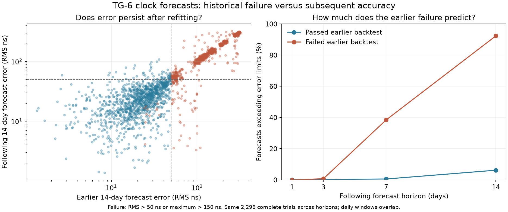
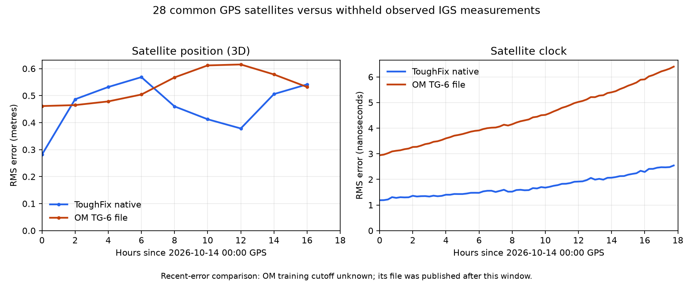

# TG-6: recent assistance-data accuracy

## Does past clock-prediction error predict the next forecast? (2026-10-16)

**For a fourteen-day linear forecast, yes in this sample. For one to three
days, almost all of the clocks rejected by that long-range test still meet
the current error limits.** This measures clock prediction accuracy under
our chosen limits, not the TG-6's acquisition requirements.

The study uses 106 daily observed IGS Rapid products from July 1 through
October 14, 2026, distributed by [NOAA](https://www.ngs.noaa.gov/CORS/data.shtml).
The production TG-6 clock fitter reconstructs daily forecasts at 76 cutoffs
from July 18 through October 1, across 32 GPS PRNs. At each cutoff:

1. Fit three days ending fourteen days earlier; score its following fourteen
   days to obtain the historical backtest result.
2. Refit using the latest three days strictly before the cutoff.
3. Freeze that new model and evaluate its TG-6-quantized offset/drift against
   the following 1, 3, 7 and 14 days of observations.

For example, at July 18 the old model trains on July 1–3 and predicts July
4–17. The new model trains on July 15–17 and predicts July 18 onward. Its
training epochs never include its future scoring period. The independent
Python scorer reproduces every production gate decision for the current
eligible models. Thresholds remain **50 ns RMS / 150 ns maximum**, fixed
before collecting this dataset. Individual errors and common clock offsets
are not removed.

There were 2,432 attempted forecasts. Twenty-nine failed the existing recent
fit checks. Of the remaining 2,403, 38 lacked an acceptable historical model
and 48 lacked sufficient historical scoring observations. The primary table
uses the same **2,296 complete paired cases** across every future horizon:

| Following forecast period | Exceeded limits after a prior pass | Exceeded limits after a prior failure |
| --- | ---: | ---: |
| 1 day | 1 / 1,224 (**0.08%**) | 0 / 1,072 (**0%**) |
| 3 days | 3 / 1,224 (**0.25%**) | 8 / 1,072 (**0.75%**) |
| 7 days | 7 / 1,224 (**0.57%**) | 412 / 1,072 (**38.43%**) |
| 14 days | 76 / 1,224 (**6.21%**) | 990 / 1,072 (**92.35%**) |



Daily windows overlap and each satellite recurs, so these counts are not
independent experiments. A sensitivity check uses cutoffs 31 days apart,
making the complete observation windows disjoint. For fourteen-day forecasts,
37 of 40 prior failures failed again (**92.5%**), compared with 2 of 47 prior
passes (**4.3%**). July, August and September cutoff groups show the same
direction. This is descriptive evidence over one season, not a calibrated
probability for every future clock or operating regime.

Across satellites, prior and following fourteen-day RMS errors have rank
correlation **0.897**. After subtracting each satellite's average log error,
the within-satellite correlation is approximately **−0.017**. This suggests
that much of the signal reflects persistent differences between satellites.
A recent above-average miss by one clock has little additional predictive
value in this sample. These associations do not establish a physical cause.

The practical implication is to distinguish long-range forecast suitability
from immediate assistance usefulness. An earlier failure provides substantial
evidence against promising fourteen days at the current precision. It provides
little justification for withholding all short-term assistance. Shorter
validity is a candidate for improving coverage; its receiver behaviour and
effect on acquisition time still need testing.

This is a retrospective reconstruction, not a collection of assistance files
actually issued on those dates. The [IGS documents](https://igs.org/products/)
the publication delay of Rapid products; this study does not reconstruct
their historical arrival times. It evaluates only clock forecasts. It does
not separately model orbit error, satellite-health exclusions, PRN reassignment,
or receiver acquisition. Missing truth and unavailable histories are recorded
separately, with additional results including unavailable histories in the
full policy-rejection group.

The [complete JSON results](figures/tg6-clock-persistence.json) include
per-satellite, per-month and disjoint-window checks, input hashes, source-code
hashes and exclusions. The [case CSV](figures/tg6-clock-persistence.csv),
[plot PDF](figures/tg6-clock-persistence.pdf), frozen coefficients and cached
source products make the calculation reviewable. The latter two are retained
in the ignored local `research/clock-backtest/` archive.

Reproduce the export and scoring with the public audit tools:

```sh
python3 scripts/fetch-clock-audit.py --start 2026-07-01 --end 2026-10-14 --output research/clock-backtest/data
TOUGHFIX_CLOCK_AUDIT_DATA=research/clock-backtest/data TOUGHFIX_CLOCK_AUDIT_OUTPUT=research/clock-backtest/frozen-forecasts.json cargo test --locked predictor::clocks::audit_tests::export_historical_clock_forecasts -- --ignored --exact
python3 scripts/score-clock-audit.py --data-dir research/clock-backtest/data --forecasts research/clock-backtest/frozen-forecasts.json --output docs/figures/tg6-clock-persistence
```

The optional Python scorer requires NumPy and Matplotlib; these are research
dependencies and are not needed by the installed app. Its numerical, prediction
flag and source-integrity checks run with `python3 -m unittest discover -s
scripts -p test_clock_audit.py`.

## Separate TG-6 linear-clock validation (2026-10-16)

TG-6 clocks are now fitted independently as linear models. The TG-1 predictor
continues selecting between linear and quadratic models. A separate causal
14-day historical prediction test admits or excludes each TG-6 clock using
observed error, with limits of 50 ns RMS and 150 ns maximum. These application
heuristics assess past performance; they do not guarantee future accuracy.

For a frozen **2026-10-15 00:00 GPS** forecast on identical cached inputs:

| Check | Result |
| --- | --- |
| TG-6 satellites before health exclusions, old / new encoder | 12 / **19** |
| Following day's observed clock error, new encoded file | **1.997 ns RMS**, 7.544 ns maximum |
| Following day's orbit error at stored knots | **0.334 m RMS** |
| TG-1 output | Byte-for-byte unchanged |
| Separate Python TG-6 encoder | Byte-identical to Rust |

All scored next-day observations were excluded from the fits and clock
acceptance decisions. The clock check fitted three days ending October 1,
then predicted October 1–14; it did not use October 15 observations. Independent
NumPy linear fits and 14-day scores reproduce the native results. The reference
for October 15 is the observed half of `igu24405_00.sp3.gz`; predicted samples
are excluded. This is a retrospective calculation, not a reconstruction of
product arrival times.

The latest cached **2026-10-16 00:00 GPS** forecast has **14 health-cleared
satellites**, compared with 9 under the previous encoder on those same inputs.
That separate offline publication used an existing health snapshot; camera
uploads still require a successful live health check within one hour.

Input hashes, per-satellite validation errors and the full results are in
[tg6-linear-clock-validation.json](figures/tg6-linear-clock-validation.json).
No camera upload or acquisition-time measurement was performed for this change.

## Earlier paired comparison (2026-10-14)

Evaluated 2026-10-14 (local date). **ToughFix has lower measured errors than the
current OM TG-6 file in this short, retrospective comparison.** This does not
establish a winner over the complete two-week prediction period or measure
the camera's position accuracy.

Both files were checked against the **same observed IGS measurements**, rather
than treating OM's predictions as truth. The evaluation covers **2026-10-14
00:00–17:45 GPS**. Only the observed half of the Ultra-rapid product is used;
predicted samples are excluded by both flags and the product's time interval.
[IGS documents the observed/predicted split and product accuracy](https://igs.org/products/).

## Results including TG-6 encoding

The independently generated TG-6 candidate contains 20 satellites, of which
18 also occur in OM's file. Its positions and clocks were decoded from the
actual generated binary before scoring. Satellites whose selected native
clock model is quadratic cannot be represented by the recovered linear-clock
format and were excluded **before** evaluation, using the existing export
rule. The same 18 satellites and timestamps are used on both sides.

| Error against observations | ToughFix TG-6 candidate | OM TG-6 file |
| --- | ---: | ---: |
| Satellite position, 3D RMS | **0.524 m** | 0.583 m |
| Position, 95th percentile | **0.717 m** | 0.862 m |
| Position, maximum | **2.204 m** | 2.242 m |
| Satellite clock RMS | **2.172 ns** | 3.322 ns |
| Clock, 95th absolute percentile | **4.472 ns** | 8.812 ns |
| Clock, maximum absolute | **10.817 ns** | 16.470 ns |

There are **162 paired orbit samples** and **1296 paired clock samples**.
ToughFix's RMS errors are approximately **10% lower for position** and **35%
lower for clocks** in this representable subset. Clock errors are relative to
the IGS timescale; no common offsets or per-satellite biases were removed.

## Full native calculation

Before the linear-clock format restrictions, all **28 satellites** in OM's
file can also be compared with the native ToughFix calculation. This includes
the native predictor's selected quadratic clocks, so it is a calculation
benchmark, distinct from the encoded TG-6 subset above.

| Error against observations | ToughFix native | OM TG-6 file |
| --- | ---: | ---: |
| Satellite position, 3D RMS | **0.471 m** | 0.538 m |
| Position, 95th percentile | **0.678 m** | 0.712 m |
| Satellite clock RMS | **1.774 ns** | 4.588 ns |
| Clock, 95th absolute percentile | **3.375 ns** | 9.747 ns |

This comparison uses **252 paired orbit samples** and **2016 paired clock
samples**. ToughFix has lower orbit RMS on 22 of 28 satellites and lower clock
RMS on 23 of 28. The aggregate advantage occurs in each six-hour block, rather
than depending on one favorable time interval. Individual errors and maxima
are retained in the research results.



## What the result establishes

The native forecast was rebuilt from three days of satellite observations
strictly before **2026-10-14 00:00 GPS**. Its last fitted orbit and clock samples
are at **2026-10-13 23:45 GPS**. No evaluation-period satellite samples or OM
coefficients were used to fit it. The current IERS Earth orientation was used
for both the native fit and reference-frame conversion. An independent rescore
using the native terrestrial positions agrees with the inertial-coordinate
scorer within **9 nanometres**; that is an implementation consistency check,
not a claim of nanometre physical accuracy.

The conclusion is limited in several ways:

* This is a **retrospective fit**, not a reconstruction of what was available
  in real time at midnight. Some fitted IGS products arrived after the cutoff,
  and the Earth-orientation file was also obtained later.
* OM's file has HTTP Last-Modified **2026-10-14 19:00:37 UTC**, after the entire
  evaluation window. Its actual training cutoff is unknown. Its clock reference
  epoch is October 12, but a reference epoch does not identify the last fitted
  observation. Equal information availability or prediction age is not proven.
* Orbit scoring uses exact two-hour state knots through 16:00 GPS. It does not
  assume an unverified receiver interpolation algorithm between knots. Clock
  scoring uses 15-minute observations through 17:45 GPS.
* The reference is observed IGS Ultra-rapid, rather than a later Final product.
  More days of held-out observations are needed to assess forecast aging.
* Satellite assistance errors do not directly measure camera location error,
  acquisition time, receiver acceptance, or the unresolved ancillary tables.

The encoded candidate remains an offline research artifact. No upload or
change to operational camera support was made for this comparison. The frozen
files can be rescored against later observations without refitting, to measure
how these particular forecasts age.

Subsequent work ported the encoder into the native app and completed a
successful camera upload. See the separate
[hardware validation record](tg6-format.md#native-integration-and-hardware-validation);
that upload does not extend the accuracy evidence reported here.

## Reproducibility

The scorer, paired CSV, full JSON, and frozen native diagnostics are preserved
locally under `research/tg6/accuracy/` (the existing ignored research archive).
The scorer is `research/tg6/accuracy_compare.py`; the generator and decoder are
`research/tg6/generate.py` and `research/tg6/sony_cep.py`. The research suite
passes 14 tests, including checks that unflagged predicted Ultra-rapid halves
are rejected and position/clock prediction flags are handled independently.
Public summary statistics and input hashes are in
[tg6-accuracy-data.json](figures/tg6-accuracy-data.json).

Key inputs are pinned by SHA-256:

| Input | SHA-256 |
| --- | --- |
| Official `cep_pak.bin` | `09a0f53b3d20bcd8d982e403be717834c7942cec70c1f73c70ed5a48b5965993` |
| Independent encoded candidate | `cc0c404a2f2632db8884ec46abee799062db080897aa6888db73acd52bb107bd` |
| Observed `igu24403_18.sp3.gz` | `cd598378bb9769aab7b2418de87bb2439cae369d6511ca97466981552433aa37` |
| IERS `finals2000A.all` | `0baf00f67a39ab362a3e4f07d2a1f084842178523f56bcf5a861e7ac084d411a` |

The reference was obtained from
[NOAA's public archive](https://noaa-cors-pds.s3.amazonaws.com/rinex/2026/287/igu24403_18.sp3.gz);
the official specimen came from the endpoint recovered from OM Workspace,
as described in the [format investigation](tg6-format.md).
